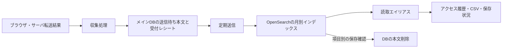

# アクセス履歴のOpenSearch保存・検索設計

## 対象

アクセスログの受付と公開コンテンツ側の契約は [アクセスログ仕様](access-log.md) を参照する。本設計では、メインDBを永続的な送信待ちキューとして使い、履歴本文の保存・検索・CSV出力・保存状況の統計をOpenSearchへ移す。

文書全文検索とは別のインデックスを使う。ランキングの集計API・画面は今回の対象に含めない。後述の集計例は、将来の機能で件数の意味と識別方法を揃えるための設計上の基準である。

## データの役割と処理経路

| 保存先 | 役割 | 削除条件 |
| --- | --- | --- |
| メインDB `access_event` | OpenSearchへ未送信、または保存確認後のDB削除が完了していない本文 | OpenSearchの項目別保存確認と受付レシートの確保が完了した場合のみ |
| メインDB `access_event_receipt` | `(library_id, event_id)` ごとの短期重複排除 | 受付から8日を過ぎ、対応する送信待ち本文がない場合 |
| OpenSearch | 送信済みの履歴本文、一覧・CSV・統計の検索対象 | 設定された保持日数に従う受付日時での削除 |

収集APIの `204` はメインDBへの永続受付、または同じイベントの受付済み確認を意味する。OpenSearchで検索できることを意味しない。OpenSearchの停止中も、メインDBへの受付が成功すれば `204` を返せる。DB受付に失敗した要求を保存済みとして扱わない。

一覧・CSV・保存状況はOpenSearchを参照する。障害時にDBの送信待ち本文を履歴の代替として返さず、検索基盤を利用できない場合は `503` を返す。送信間隔とインデックスのrefreshにより、正常時にも表示まで時間がかかる。

## 原子的な受付と短期重複排除

`AccessEventRepository` は `mainJdbcTemplate` の実DataSourceを使う `TransactionTemplate` で、次を同時に確定する。

1. `(library_id, event_id)` を主キーとする受付レシートを登録する。期限は初回受付日時の8日後。
2. イベント本文を送信待ちテーブルへ登録する。本文にも同じ組の一意制約を持つ。

一方が失敗した場合は両方をロールバックする。レシートまたは本文の重複はトランザクションの外側で処理し、該当する受付済みレシートまたは本文が存在することを確認して成功として扱う。未知の一意制約違反を保存済みと判断しない。

再送では、最初の本文・数値ID・発生日時・受付日時を維持する。送信済み本文をDBから削除した後もレシートが再登録を防ぐため、受付日時の更新や、変更された発生日時による別月への二重登録を防げる。

レシートは永久のイベント識別台帳ではない。収集APIが受け付ける発生日時は受付時点の7日前から5分後までであり、8日間のレシートは通常の再送をこの範囲より長く保護する。レシートの整理では、期限を過ぎても対応する送信待ち本文がある行を除外する。

## 送信・項目別確認・再開

`AccessLogDispatcher` の既定動作は次のとおり。

| 項目 | 値・動作 |
| --- | --- |
| 起動後の初回実行 | 60秒後 |
| 実行間隔 | 前回終了から30秒 |
| 読取バッチ | 数値ID順に最大500件 |
| 1実行のバッチ数 | 最大10回 |
| 再試行待機 | `next_attempt_at` を現在の60秒後へ設定 |
| 一時停止 | `astack.access-log.dispatch-enabled=false` |

送信・保持期限削除は専用の2スレッドスケジューラで実行し、OpenSearchの通信待ちで既存のビルド・AIジョブ用の既定スケジューラを占有しない。

対象は `next_attempt_at` が未設定、または再試行時刻を過ぎた本文である。固定のOpenSearch `_id` と `create` 操作で送信し、bulk全体のHTTP成功だけで本文を削除しない。返された項目の操作・対象インデックス・IDを送信内容と対応付け、次の場合だけ保存を確認したとみなす。

- `201`、項目エラーなし、確認できるシャード失敗なし。
- `409` かつ `version_conflict_engine_exception`。同じインデックス・IDの文書が既に保存されているため、初回を維持する。

成功した数値IDだけを `acknowledge` へ渡す。既存履歴から移行した本文にはレシートがない場合があるため、元の受付日時から期限を補完し、同じDBトランザクションで本文を削除する。レシートの補完または本文削除に失敗した場合は本文が残り、次回も同じインデックス・IDへ送る。

項目別に失敗した本文は残し、60秒待機させて後続の本文を処理する。これにより、mapping違反などの継続的な失敗が先頭バッチを占有して後続を止めることを避ける。通信全体の失敗、応答不明、DB確認の失敗では、その実行を打ち切る。

保存後に応答を受け取れずタイムアウトした場合も、確認できない本文は残す。次回の `create` が `409` となれば保存済みとして回収できる。プロセス停止・再起動・送信処理の一時停止でもDB本文を残すため、再開後に送信を続けられる。

複数インスタンスが同じ本文を取得しても、固定IDの `create` とDBの一意制約・トランザクションで初回を維持する。DB削除の競合は本文を失う根拠にせず、失敗時は次回実行へ委ねる。送信待ち本文は保持日数では削除しない。

## 既存履歴の移行

既存の `access_event` 行をそのまま送信待ちとして扱う。初期化時に `next_attempt_at` とレシート用テーブルを追加し、既存の数値ID、イベントID、ライブラリID、本文、発生日時、受付日時は変更しない。

起動時に本文を一括削除したり、全件を一度にメモリへ読み込んだりしない。定期送信が既存行もバッチで移行し、OpenSearchの保存確認後に初めてDB本文を削除する。全件のレシートを起動時に作る必要はなく、移行行の確認処理と本文削除を同時に確定する。

移行中に既存行と同じイベントが再送された場合、本文の一意制約で新本文を拒否し、その要求で作りかけたレシートもロールバックする。元の本文は残り、後で正常に送信された時点でレシートを補完する。

移行完了前は、OpenSearchに反映済みの分だけが履歴・統計に現れる。移行前のDB件数と、移行中のOpenSearch件数が直ちに一致するとは限らない。

## インデックス・識別子・文書版

### 専用の月別インデックス

既定の物理インデックス名は `astack_access_events_v1_yyyy.MM`、読取エイリアスは `astack_access_events`。月は `eventTime`、すなわち最初に受け付けた `occurredAt` をUTCで判定する。受信した月、送信した月、サーバのローカルタイムゾーンでは分割しない。

発生日時と送信先月は送信待ち本文から毎回同じ方法で求める。本文を再送時に上書きしないため、月をまたいだ再試行でも同じ物理インデックスへ送信できる。OpenSearchの `_id` はインデックス内で一意であり、別月インデックスをまたいで重複を排除するものではない。受付レシートによる再登録防止と合わせて扱う。

新規インデックスは、明示したmapping、`refresh_interval=30s`、1シャード、レプリカ0、`auto_expand_replicas=0-1` で作成する。本文の保存を確認する前に、専用の読取エイリアスへ参加させる。

読取エイリアスがない場合は、OpenSearch上で実際に利用できる空インデックスを用意し、既存の対象月インデックスもエイリアスへ復元する。正常に初期化・検索できた結果が0件なら空一覧を返せる。接続・権限・初期化・検索の失敗を0件へ置換しない。他用途のインデックスがエイリアスへ混在した場合も検索・削除を止める。

### イベントIDと対象の識別

| 項目 | 算出・意味 |
| --- | --- |
| `eventId` | 受付要求のUUID。DBではライブラリIDとの組で一意 |
| `_id` / `documentId` | `SHA-256(libraryId, eventId)`。再送時の初回保存を維持する |
| `id` | メインDBで採番した数値ID。元のIDを履歴へ保存し、並び順の一部に使う |
| `resourceKey` | `SHA-256(libraryId, targetKind, relativePath)`。同じ対象を集計するための派生値 |
| `documentVersion` | 署名済みの原本文書SHA256。版別の比較に使い、不明値を最新の版で補わない |
| `schemaVersion` | 保存するイベント文書のスキーマ版。現在は1 |

ハッシュ入力は、各値を文字列化し、文字列の長さと `:` を前置した値を順に連結してUTF-8へ変換する。NULLは `-1:` とする。Java実装の文字列長を使い、単純な区切り文字連結による曖昧さを避ける。

`resourceKey` は対象パスの文字列を基準にし、版を含めない。版別集計は `resourceKey` と `documentVersion` の組で行う。フォルダと文書は `targetKind` で分離する。移動・改名で `relativePath` が変わった対象は別リソースになる。同じパスでも公開元のルートが変更された場合に追跡を分ける識別子は、今後の追加設計が必要である。公開元の署名検査に使う識別子を、現行の `resourceKey` に含めているとはみなさない。

### フィールドの型とmapping

mappingの正本は [event-mapping-v1.json](../../backend/src/main/resources/access-log/event-mapping-v1.json)。`dynamic: strict` とし、未知のフィールドを暗黙の型で追加しない。

| 型 | 主なフィールド | 用途 |
| --- | --- | --- |
| `long` | `id`、`libraryId`、`projectId`、`schemaVersion` | 正確な識別・ソート・数値条件 |
| `date` | `eventTime`、`receivedTime` | 発生時刻・受付時刻。ISO日時またはepoch millis |
| `keyword` | `eventId`、`type`、`targetKind`、`result`、`sessionId`、`documentVersion`、`resourceKey`、`documentId`、対象パスなど | 完全一致・集計・安定したソート |
| `ip` | `clientIp` | サーバが取得した数値IP。未記録はNULL |

DB・公開APIの `occurredAt` / `receivedAt` は、OpenSearchでは `eventTime` / `receivedTime` として保存し、応答時に元のフィールドへ戻す。生のUser-Agent、Cookie、Authorization、例外本文を新たに保存しない。

mappingの `_meta` に `owner=astack-access-events` と `schemaVersion=1` を持たせる。保存・読取・削除の前に、対象インデックスが専用名に一致し、所有者・版・`dynamic: strict`・フィールド集合・各フィールドの型が同梱mappingと一致することを確認する。パス等のkeywordの `ignore_above`、dateのformat、検索・ソートに必要なindex/doc_values、文書本体と `_source` の有効状態も検査する。想定外のnormalizerやmappingを暗黙に受け入れない。

既存インデックスへ所有者マーカーだけを書き足して、互換性を確認せず流用しない。型やスキーマ版を変更する場合は、別の版の物理インデックス、必要な再インデックス、エイリアスの切替、それを許可する検証コードを一組で設計・適用する。今回の実装は非互換mappingを自動移行せず、本文をDBに残して保存・検索を中断する。

## 一覧・CSV・保存状況

条件にはライブラリ、イベント種別、対象パスの部分一致、受付日時範囲、セッションID、結果を使う。パス条件の `*`、`?`、バックスラッシュはリテラルとしてエスケープし、利用者入力をそのままワイルドカード指定にしない。

総件数は `track_total_hits=true` で取得する。シャード失敗・タイムアウト・部分的な結果は成功として表示しない。並び順は `receivedTime DESC`、`id DESC`、`documentId ASC` とし、同じ受付時刻の複数イベントにも一意な順序を与える。`_id` 自体をソート・集計用フィールドにしない。

`from + size` が10000以内では通常のページ検索を使い、それを超える場合はPITと `search_after` で対象ページまで走査する。PITの保持は1分で更新し、応答でPIT IDが変わった場合は最新のIDを継続・解放に使う。処理後や初期化途中の失敗時も、取得できたPIT IDを解放する。1回の走査は最大1000件、走査回数は最大1000回。深いページの走査には全体30秒の時間予算を設け、各検索に残り時間を指定し、予算を過ぎた追加走査は行わず `503` とする。通信の接続・応答待ちのタイムアウトは共有OpenSearchクライアントの設定にも依存する。別の画面操作によるページ移動では新しい検索になるため、画面をまたぐ固定スナップショットを保証しない。

CSVは現行の1回10000件制限を維持する。検索条件に一致する総件数が10000件を超える場合は、条件を絞り込むエラーを返し、一部だけのCSVを成功として返さない。保存状況の件数・最古／最新受付日時も同じ読取エイリアスから取得する。

## 将来の集計へ引き継ぐ意味

ランキングAPI・ランキング画面、定期集計結果の保存は今回実装しない。将来の集計では、少なくとも次の基準を明示する。

- 文書の表示件数は `type=DOCUMENT_VIEW` かつ `result=OBSERVED` または `SUCCEEDED` を対象とし、`FAILED` を除外する。旧行の結果未記録を含める場合は、互換ルールを別途決める。
- `OBSERVED` は文書ページの表示、`SUCCEEDED` は対応ビューアでの表示成功を意味する。異なる計測範囲を、利用者の実閲覧完了の証明として扱わない。
- `DOWNLOAD_REQUEST` はブラウザの要求、`DOWNLOAD_TRANSFER` はサーバで観測した転送結果。同じ操作に両方が対応する場合があるため、合算してダウンロード回数にしない。
- 同一文書の利用量は `resourceKey`、版別比較は `resourceKey` と `documentVersion` を使う。版不明の行を既知の版に割り当てない。
- `sessionId` はタブ内の参考識別子であり、認証済みユーザ数・人数として集計しない。

上位項目を探す [`terms` 集計](https://docs.opensearch.org/latest/aggregations/bucket/terms/)は、複数シャードや複数インデックスでは候補の取りこぼしや件数の誤差を考慮する。`shard_size` を大きくするだけで常に厳密になるとはみなさない。正確な対象別件数が必要なら、固定した対象期間・検索条件で [`composite` 集計](https://docs.opensearch.org/latest/aggregations/bucket/composite/)の全バケットを `after_key` で巡回し、全件から上位を選ぶ。全バケットの走査だけで、更新中のデータが自動的に一時点へ固定されるわけではないため、確定済み期間またはスナップショットの扱いも定める。

## 保持期間と容量

保持日数の設定は全ライブラリ共通で、既定0は自動削除なし。0以外では現在時刻から日数を引き、`receivedTime` がそのしきい値より古い履歴をOpenSearchのDelete by Queryで削除する。

起動直後には削除せず、1時間後から毎時実行し、1回最大10000件を処理する。完了応答のタイムアウト・失敗・競合を確認し、不完全な削除を完了件数として扱わない。削除済みの項目は失敗時にも自動でロールバックされないため、次回も同じ時刻条件で処理する。

インデックスの分割は発生日時、保持期限は受付日時である。古い月のインデックスにも後から受け付けた履歴が入るため、月名だけでインデックス全体を削除しない。

DBの送信待ち本文は、OpenSearch障害中や保持期限超過時も削除しない。長期障害ではメインDBが増加するため、DBの空き容量と未送信の蓄積を運用で確認する。8日間の受付レシートは重複排除用であり、履歴の保持日数とは独立して整理する。本文を削除した後もレシートが残ることは正常である。

## 移行・バックアップ・ロールバック

移行時は、レシートを参照せずDBだけへ履歴を書き込む旧版プロセスを停止してから、新しい送信処理を開始する。旧版と新版のwriterを混在させない。旧版は送信済みイベントを再登録でき、月別保存や受付日時の維持を損なう可能性がある。

移行後のDBは、未送信本文と短期レシートだけを保持する。**DBのバックアップだけでは、OpenSearchへ移してDBから削除した履歴を復旧できない。** 専用の月別インデックス、mapping、読取エイリアスを含むOpenSearchスナップショットも取得する。

復旧ではDBとOpenSearchの取得時点を確認する。DBに本文が残っているイベントは再送できるが、DBにレシートだけがありOpenSearchスナップショットにも本文がないイベントは復元できない。停止して整合した時点を取得するか、取得順序・送信停止・再開条件を含む復旧手順を定める。

アプリケーションを旧版へ戻すだけでは、履歴の保存方式は元に戻らない。DBを履歴本体として読む版へ戻す場合は、移行前の整合したDBバックアップの復元、またはOpenSearchからの明示的な逆移行が必要となる。復元時点以降に受け付けたログを失わないための退避・再取込みも別途判断する。旧版writerを動かしたまま新しい送信処理を併走させない。

## 設定と参照実装

| 設定 | 既定値 |
| --- | --- |
| `astack.access-log.dispatch-enabled` | `true` |
| `astack.access-log.dispatch-initial-delay-ms` | `60000` |
| `astack.access-log.dispatch-interval-ms` | `30000` |
| `astack.access-log.opensearch.index-prefix` | `astack_access_events_v1_` |
| `astack.access-log.opensearch.read-alias` | `astack_access_events` |

インデックス名の接頭辞・エイリアス名には検証済みの英小文字・数字・ハイフン・アンダースコアのみを使い、ワイルドカードやカンマを認めない。接続は既存の `OpenSearchClient` を利用し、全文検索のインデックスを履歴の対象へ混在させない。

- [AccessEventRepository](../../backend/src/main/java/jp/astack/backend/accesslog/AccessEventRepository.java): 送信待ち本文、レシート、トランザクション、既存行の継続利用。
- [AccessLogDispatcher](../../backend/src/main/java/jp/astack/backend/accesslog/AccessLogDispatcher.java): 定期送信、項目別確認、待機・再開。
- [OpenSearchAccessEventStore](../../backend/src/main/java/jp/astack/backend/accesslog/OpenSearchAccessEventStore.java): 月別保存、固定ID、mapping、検索・CSV用取得、統計、保持期間の削除。
- [AccessLogRetentionService](../../backend/src/main/java/jp/astack/backend/accesslog/AccessLogRetentionService.java): 保持日数設定と毎時の削除。
- [OpenSearch Bulk API](https://docs.opensearch.org/latest/api-reference/document-apis/bulk/)、[検索API](https://docs.opensearch.org/latest/api-reference/search-apis/search/)、[ページ送り](https://docs.opensearch.org/latest/search-plugins/searching-data/paginate/)、[Delete by Query](https://docs.opensearch.org/latest/api-reference/document-apis/delete-by-query/)。
